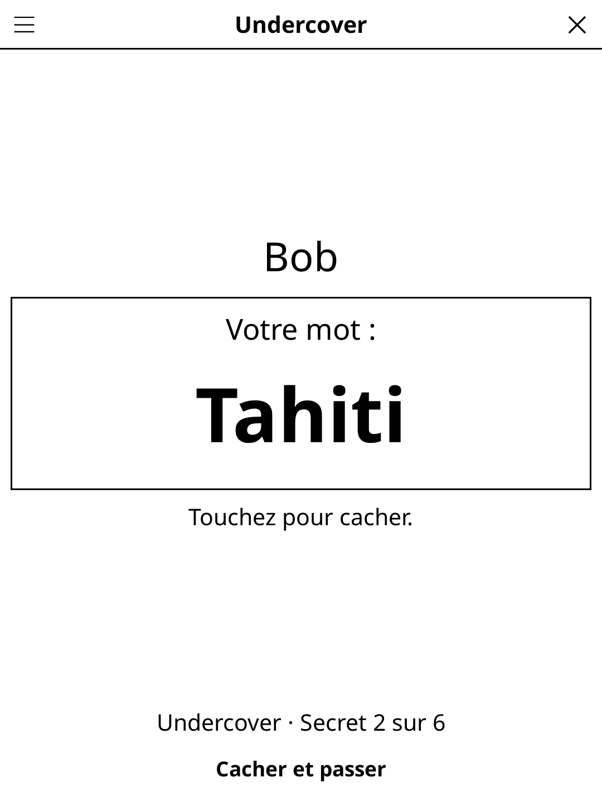

# undercover.koplugin

**Undercover** for [KOReader](https://github.com/koreader/koreader) — a social-deduction party game for 3 to 12 players, played with one e-reader passed round the table.

## Screenshot



## Concept

Everyone gets a secret, privately, one after the other: a hand-over screen asks for the next player ("Pass the reader to Chloé — tap when ready"), the secret only appears after a tap and disappears with the next tap. Then the table talks, votes, and the reader reveals the role of whoever was voted out.

### Undercover mode

- The **civilians** share a word (*Paris*). The **undercovers** (1–3) get a close one (*Rome*) — and don't know they are undercover.
- **Mr. White** (optional, from 5 players) gets no word and must bluff.
- Each player in turn gives one clue about their word, then the group votes someone out. Their role is revealed.
- An eliminated Mr. White may type a guess for the civilians' word (case, accents, articles and one typo forgiven): right, and he wins alone.
- Civilians win when every infiltrator is out; the infiltrators win when only one civilian is left.
- Points: 2 per civilian, 10 per undercover, 6 for Mr. White. Scores add up round after round.

### Spy mode

- Everyone sees the same place or famous scene (*Le Titanic*, *L'atelier de Léonard de Vinci*, *Hogwarts*…) and a role — except the **spy**, who sees nothing.
- Players question each other, then vote once. Wrong player: the spy wins. Spy caught: he gets one try at naming the place. The spy may also give himself up at any time and name it.
- The group can overrule the program and accept a spy's guess that was "close enough".

## Features

- Player names typed once and remembered; scores across rounds.
- No repeats: a pair or place already played (in any session) only comes back once all the selected packs have been played.
- Optional discussion timer (1–5 min); only the digits refresh, once a second.
- Content language (FR/EN) independent of the interface language.
- Six themed packs, picked in the menu (multi-select, with counts): History & legends, Geography & monuments, Pop culture, Food, Kids, Mix & laughs.
- 1460 French and 1293 English word pairs — lots of proper nouns (Napoléon/Jules César, tour Eiffel/tour de Pise, Batman/Superman, camembert/brie…) and silly ones (Belle-mère/Dragon).
- 365 French and 362 English places and scenes for the spy mode, each with 4–7 roles.
- A game in progress is saved when the screen is closed; a secret is never shown on reopening, the hand-over screen comes back first.

## Settings (title-bar menu)

New game · Language · Players · Mode · Packs · Undercovers (Auto/1/2/3) · Mr. White · Timer · Rules

## Development

`game.lua` holds the rules (pure Lua, no UI), `screen.lua` the screens, `players.lua` the player-name editor, `content/<lang>/` the word pairs and places, one file per pack (`pairs_<pack>.lua`, `places_<pack>.lua`, plain Lua tables loaded on first use; all packs of one language take about 330 KB once loaded). `test_game_spec.lua` covers the rules, the lenient guess comparison and the content.

```
busted test_game_spec.lua
```

## License

GPL-3.0
